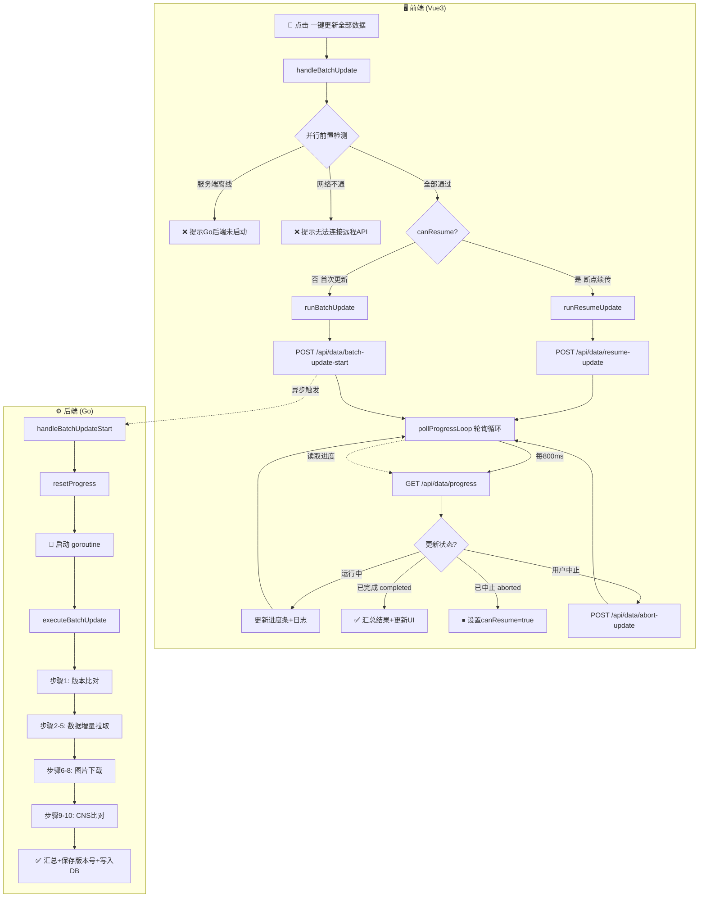
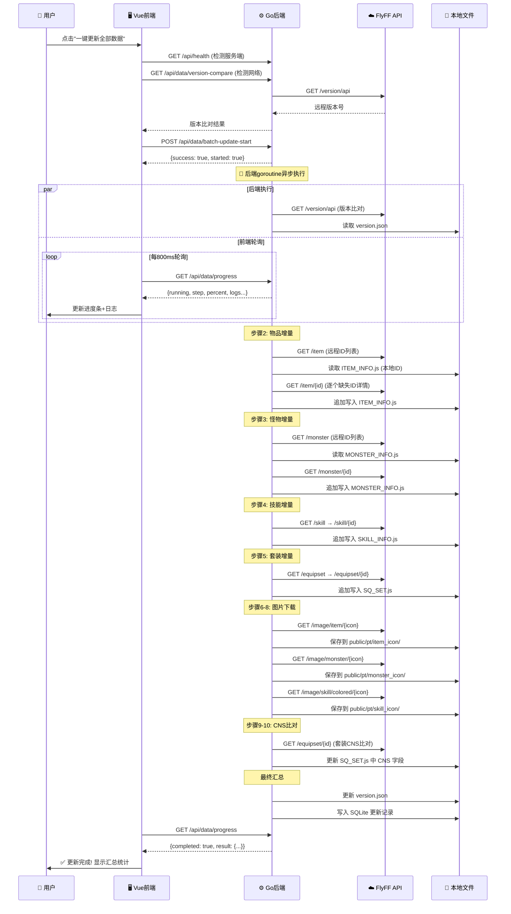

<!--
  @file ApiUpdater-FlowChart.md
  @description "一键更新全部数据"按钮完整执行流程图
  @description 使用 Mermaid 语法绘制，需在支持 Mermaid 的 Markdown 查看器中预览
-->

# "一键更新全部数据" 完整执行流程图

## 一、整体架构流程



## 二、10步详细执行流程

```mermaid
flowchart TB
    START([🚀 一键更新全部数据]) --> S1

    subgraph S1["步骤1/10 🔍 版本比对"]
        S1A[请求 https://api.flyff.com/version/api] --> S1B[读取本地 src/data/version.json]
        S1B --> S1C[按语义化版本逐段比对]
        S1C --> S1D{版本是否变化?}
        S1D -->|是| S1E[需要更新]
        S1D -->|否| S1F["仍执行全量ID比对<br>(防手动删除/文件损坏)"]
        S1E --> S1G[保存版本比对结果]
        S1F --> S1G
    end

    S1G --> S2

    subgraph S2["步骤2-5/10 📊 数据增量拉取 (item→monster→skill→equipset)"]
        S2A["获取远程ID列表<br>GET https://api.flyff.com/{endpoint}"] --> S2B["保存ID列表<br>public/data/{category}_id.json"]
        S2B --> S2C["解析本地JS文件已有ID<br>正则匹配 '数字': 键名"]
        S2C --> S2D["计算缺失ID<br>= 远程ID - 本地已有ID"]
        S2D --> S2E{有缺失ID?}
        S2E -->|否| S2F["✅ 该类别数据已是最新<br>跳过，标记为已完成"]
        S2E -->|是| S2G["逐个获取详情<br>GET https://api.flyff.com/{endpoint}/{id}<br>速率: 290次/分, 间隔210ms"]
        S2G --> S2H["写入JS数据文件<br>追加到 export const XXX = {...} 末尾"]
        S2H --> S2I{中止?}
        S2I -->|是| S2J["💾 保存已获取数据<br>支持断点续传"]
        S2I -->|否| S2K["继续下一个类别"]
        S2F --> S2K
        S2J --> S2K
    end

    S2K --> S3

    subgraph S3["步骤6-8/10 🖼️ 图片下载 (item→monster→skill)"]
        S3A{有新增数据?}
        S3A -->|是 增量模式| S3B["从新增详情提取icon字段"]
        S3A -->|否 补全模式| S3C["扫描JS文件所有条目<br>找出本地缺失图片"]
        S3B --> S3D["去重 + 检查本地已存在<br>public/pt/{category}_icon/"]
        S3C --> S3D
        S3D --> S3E{有缺失图片?}
        S3E -->|否| S3F["✅ 图片已全部存在"]
        S3E -->|是| S3G["逐个下载<br>https://api.flyff.com/image/{category}/{icon}<br>重试3次, 超时15s"]
        S3G --> S3H["保存到<br>public/pt/{category}_icon/{fileName}"]
    end

    S3H --> S4
    S3F --> S4

    subgraph S4["步骤9-10/10 📝 CNS比对"]
        S4A["步骤9: 物品/怪物/技能CNS<br>新增数据自带最新CNS, 无需额外比对"] --> S4B["步骤10: 套装CNS名称比对<br>逐条请求API比对 name.cns"]
    end

    S4B --> S5

    subgraph S5["🏁 最终汇总"]
        S5A["保存本地版本号 = 远程版本号<br>src/data/version.json"]
        S5A --> S5B["汇总: 新增/失败数量<br>图片下载统计<br>CNS比对统计"]
        S5B --> S5C["汇总失败ID到 failedIdsMap"]
        S5C --> S5D["保存更新记录到SQLite数据库"]
        S5D --> S5E["设置 completed = true"]
    end

    S5E --> END([🎉 更新完成])

    style START fill:#667eea,color:#fff
    style END fill:#28a745,color:#fff
    style S1 fill:#e8f4fd,stroke:#3498db
    style S2 fill:#fef3e2,stroke:#e67e22
    style S3 fill:#f0e6f6,stroke:#9b59b6
    style S4 fill:#e8f8e8,stroke:#27ae60
    style S5 fill:#fce4e4,stroke:#e74c3c
```



## 三、数据流向图

```mermaid
flowchart LR
    subgraph Remote["☁️ FlyFF 远程API"]
        V[GET /version/api]
        IL[GET /item, /monster, /skill, /equipset]
        ID[GET /item/123, /monster/456...]
        IMG[GET /image/item/xxx.png]
    end

    subgraph GoBackend["⚙️ Go后端 (localhost:8080)"]
        PROXY[/api/proxy/* → 代理到远程API]
        DATA[/api/data/* → 更新控制器]
        PROXY -.-> V
        PROXY -.-> IL
        PROXY -.-> ID
        PROXY -.-> IMG
    end

    subgraph LocalFiles["📁 本地文件系统"]
        VF[src/data/version.json]
        IDL["public/data/{category}_id.json<br>(ID列表缓存)"]
        JS["src/data/ITEM_INFO.js<br>MONSTER_INFO.js<br>SKILL_INFO.js<br>SQ_SET.js"]
        ICON["public/pt/item_icon/<br>monster_icon/<br>skill_icon/"]
        DB[(flyff.db<br>更新记录表)]
    end

    DATA -->|1. 版本比对| V
    DATA -->|2. 获取ID列表| IL
    DATA -->|3. 获取详情| ID
    DATA -->|4. 下载图片| IMG
    DATA -->|写入版本| VF
    DATA -->|保存ID列表| IDL
    DATA -->|追加数据| JS
    DATA -->|保存图片| ICON
    DATA -->|写入记录| DB
```

## 四、前后端交互时序图



## 五、速率控制与容错机制

```mermaid
flowchart TB
    subgraph RateLimit["⏱️ 速率控制"]
        RL1["请求计数器 + 1分钟滑动窗口"]
        RL2["每分钟 ≥ 290次 → 等待剩余时间后重置"]
        RL3["每次请求间隔 ≥ 210ms"]
        RL1 --> RL2
        RL2 --> RL3
    end

    subgraph Retry["🔄 重试机制"]
        R1["单次API请求失败"]
        R1 --> R2["重试最多3次"]
        R2 --> R3{3次都失败?}
        R3 -->|是| R4["记录到 failedIdsMap<br>持久化到 localStorage"]
        R3 -->|否| R5["继续处理"]
    end

    subgraph Resume["🔁 断点续传"]
        RS1["用户点击中止 / 网络中断"]
        RS1 --> RS2["💾 已获取数据立即写入JS文件"]
        RS2 --> RS3["标记已完成的类别"]
        RS3 --> RS4["设置 canResume = true"]
        RS4 --> RS5["再次点击 → runResumeUpdate()"]
        RS5 --> RS6["跳过版本比对 + 已完成类别<br>从断点处继续"]
    end

    subgraph Fallback["🛡️ 降级方案"]
        FB1["远程ID列表API失败"]
        FB1 --> FB2["降级使用本地缓存ID列表<br>public/data/{category}_id.json"]
    end
```



## 六、文件对应关系

| 类别 | 远程API端点 | JS数据文件 | ID列表缓存 | 图标目录 |
|------|------------|-----------|-----------|---------|
| 物品 item | `/item`, `/item/{id}` | `src/data/ITEM_INFO.js` | `public/data/item_id.json` | `public/pt/item_icon/` |
| 怪物 monster | `/monster`, `/monster/{id}` | `src/data/MONSTER_INFO.js` | `public/data/monster_id.json` | `public/pt/monster_icon/` |
| 技能 skill | `/skill`, `/skill/{id}` | `src/data/SKILL_INFO.js` | `public/data/skill_id.json` | `public/pt/skill_icon/` |
| 套装 equipset | `/equipset`, `/equipset/{id}` | `src/data/SQ_SET.js` | `public/data/equipset_id.json` | — |
